# N’GAME — 52 écrans proposés à la validation

17 octobre 2026 · 13 planches de 4 écrans · Maquettes générées, non intégrées à Unity.

La direction conserve le conte en papier, les cartes validées, le bleu nuit, le parchemin et les lumières ambre. Le Président reste un chapitre à venir sans nouvelle direction de jeu imposée.

Le [plan d’exécution](../../../Documentation/PLAN-EXECUTION.md) et la [recette du joueur](../../../Documentation/RECETTE-JOUEUR.md) définissent la suite. Les 52 écrans ne sont pas tous validés individuellement. Les compléments N/O sur les vues simultanées, le chat, le clavier et le micro sont **planifiés, non générés**.

## Navigation à figer après validation

- Avant de rejoindre un salon : retour en haut à gauche ; aide ou réglages en haut à droite.
- Du salon à la fin de partie : **burger en haut à gauche**, jamais une sortie directe.
- « Quitter la partie » est séparé dans le menu, puis demande une confirmation. « Rester dans la partie » est le choix principal. L’entrée du menu et la confirmation ne partagent pas leur emplacement tactile.
- Deux emplacements fixes en bas : bouton principal en terre cuite sur la rangée supérieure ; commande secondaire sur la rangée inférieure. Un bouton désactivé garde sa place.
- Pendant les actions de jeu, la rangée secondaire porte l’accès au rôle privé ; un écran d’aide ou un résultat remplace cette action dans la même zone, sans déplacer la rangée.
- Une interruption, un menu ou une reconnexion masque les secrets. La reconnexion ne révèle pas automatiquement une carte.

Le gabarit cible est de 430 × 932 unités : en-tête de 80, action principale x24/y780/l382/h56, action secondaire x24/y846/l382/h48, réserve basse conservée. Les coordonnées désignent le coin supérieur gauche. Ce sont les contraintes à reproduire dans Unity après accord, indépendamment des petites variations de rendu des images générées.

Le prompt de la planche A inverse les rangées des boutons : le gabarit ci-dessus et le plan d’exécution font référence. Les images et prompts d’origine restent conservés.

## Planches et repères

### A — Entrer dans le conte

- **A01** — Accueil
- **A02** — Bibliothèque de jeux
- **A03** — Fiche Loup-Garou
- **A04** — Pseudo et portrait

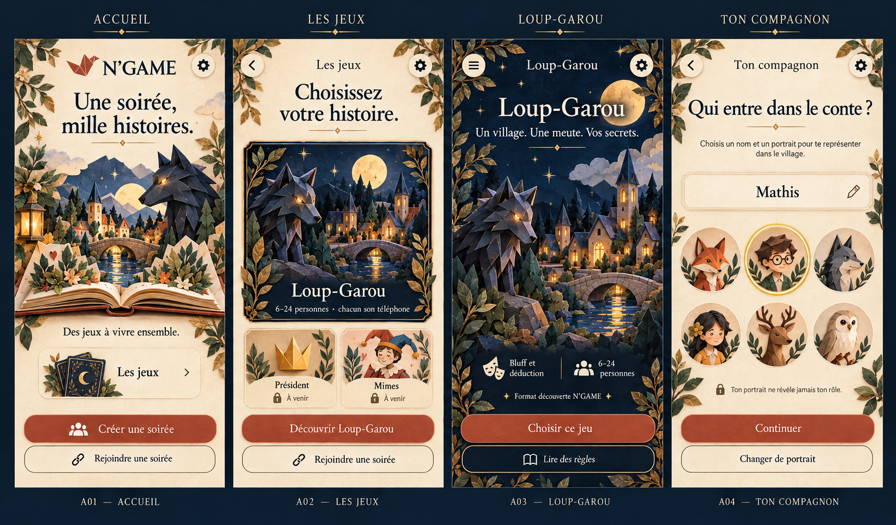

### B — Se retrouver

- **B05** — Créer et choisir le mode
- **B06** — Rejoindre par code
- **B07** — Salon en attente
- **B08** — Salon prêt

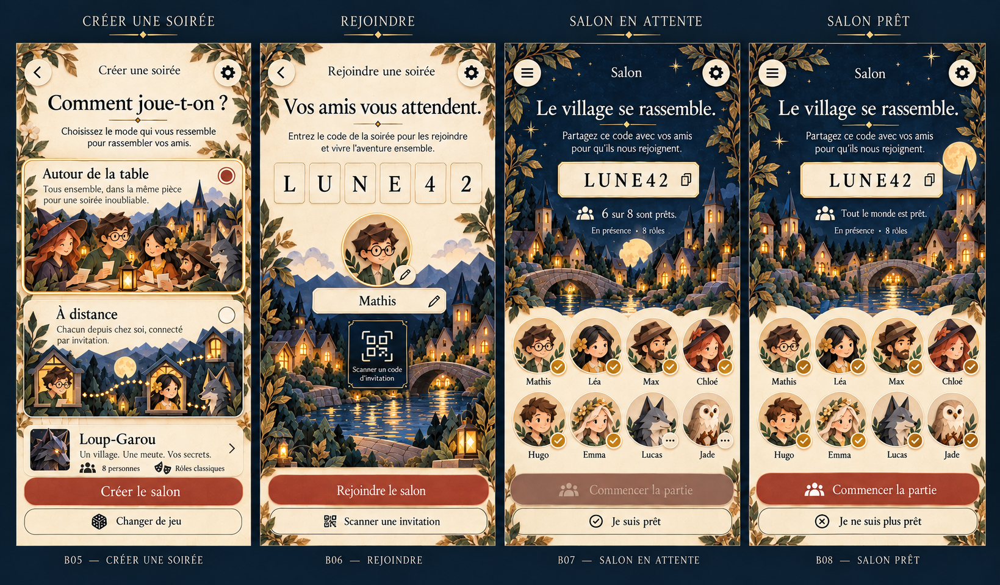

### C — Préparer une vraie partie

- **C09** — Composition des rôles
- **C10** — Rythme et paramètres
- **C11** — Guide en présence
- **C12** — Guide à distance

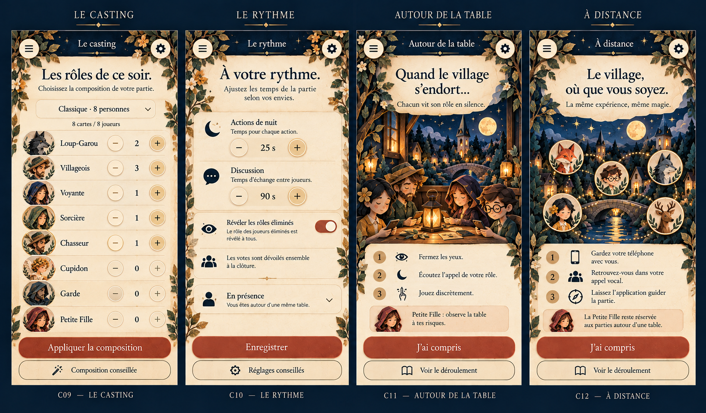

### D — Recevoir son secret

- **D13** — Distribution des cartes
- **D14** — Carte masquée
- **D15** — Carte révélée
- **D16** — Attente nocturne

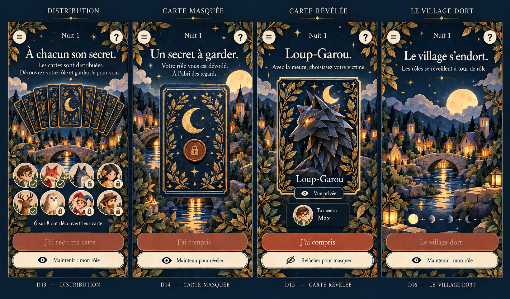

### E — Les pouvoirs de la nuit

- **E17** — Choix de la meute
- **E18** — Cible de la Voyante
- **E19** — Résultat de la Voyante
- **E20** — Protection du Garde

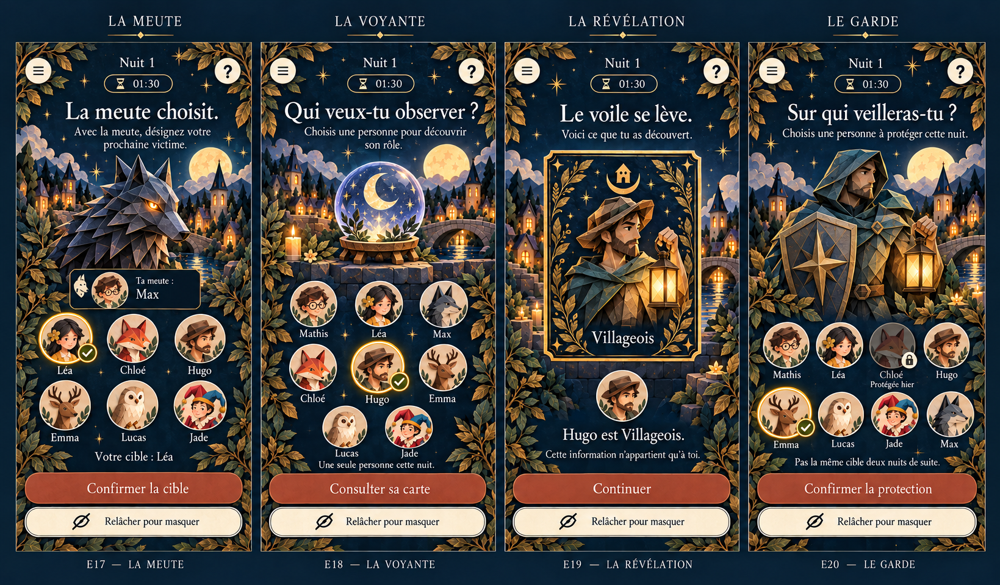

### F — Potions et destins liés

- **F21** — Choix des potions
- **F22** — Cible du poison
- **F23** — Choix de Cupidon
- **F24** — Reconnaissance des amoureux

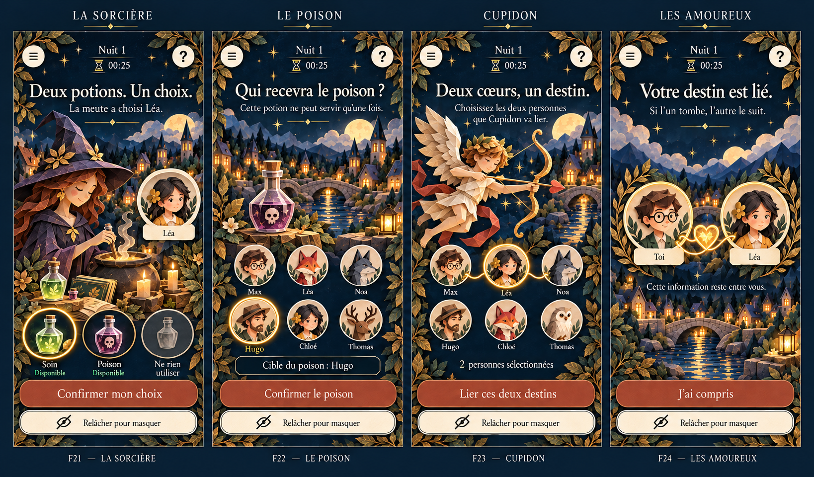

### G — De la nuit au jour

- **G25** — Petite Fille à table
- **G26** — Dernier tir du Chasseur
- **G27** — Aube et événements
- **G28** — Discussion

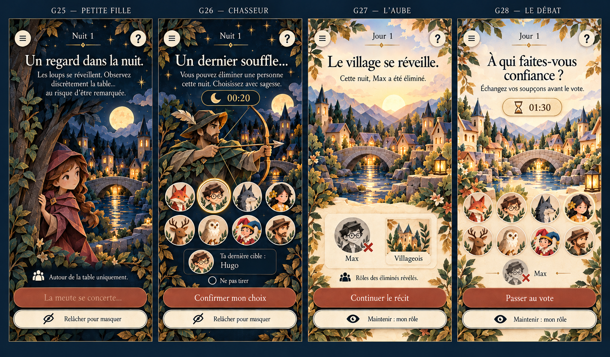

### H — Le vote du village

- **H29** — Sélection du vote
- **H30** — Vote enregistré
- **H31** — Second tour
- **H32** — Résolution du vote

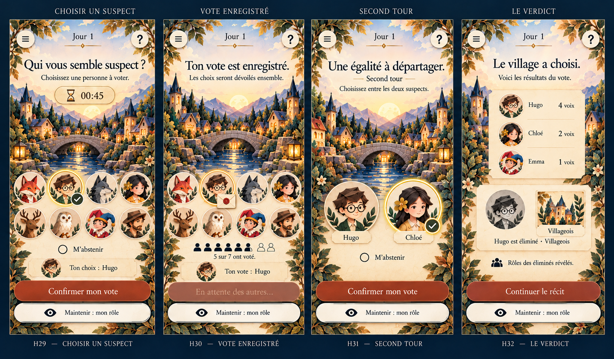

### I — Observateur et fins de conte

- **I33** — Joueur éliminé observateur
- **I34** — Victoire du village
- **I35** — Victoire des loups
- **I36** — Victoire des amoureux

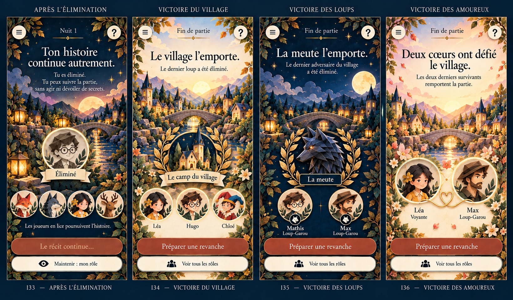

### J — Menu sûr et interruptions

- **J37** — Menu burger
- **J38** — Confirmation avant de quitter
- **J39** — Connexion interrompue
- **J40** — Connexion retrouvée

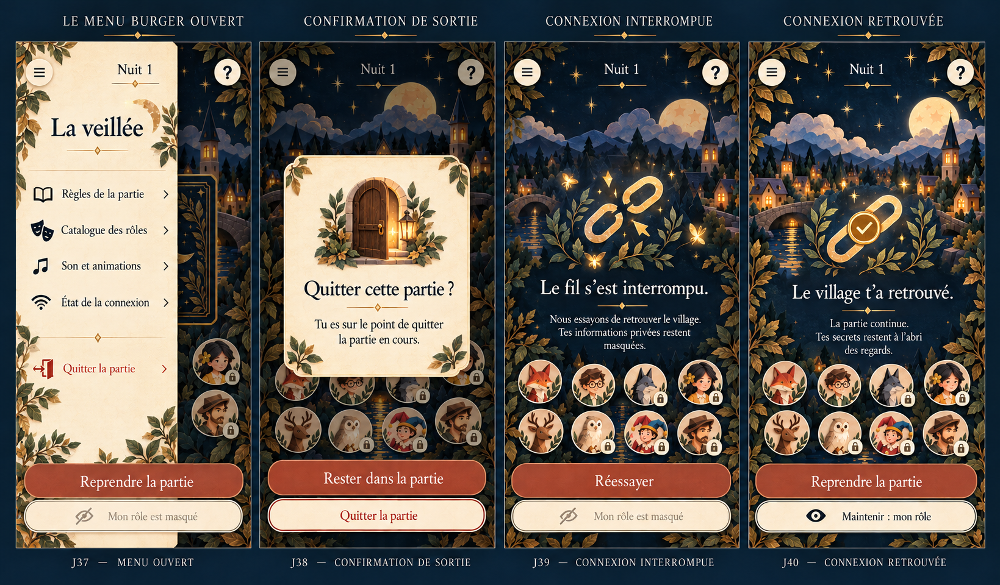

### K — Comprendre et personnaliser

- **K41** — Catalogue des rôles
- **K42** — Fiche de rôle publique
- **K43** — Réglages
- **K44** — Comment jouer

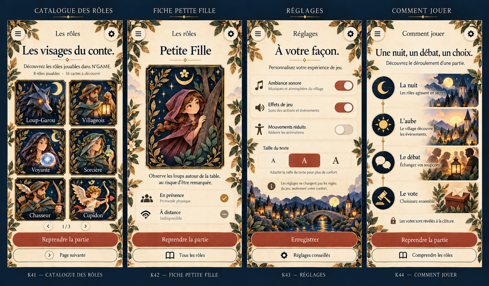

### L — Cas particuliers

- **L45** — Code incorrect
- **L46** — Salon complet
- **L47** — Introduction à l'entraînement
- **L48** — Fin sans vainqueur

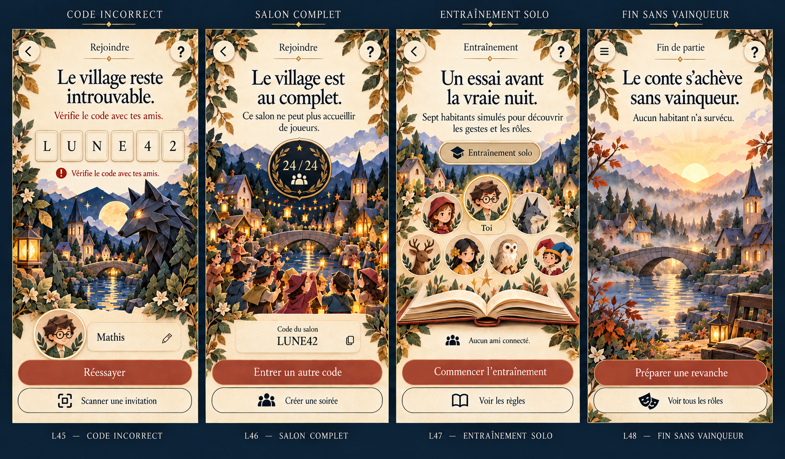

### M — Dernières transitions

- **M49** — Chargement
- **M50** — Partie déjà commencée
- **M51** — Salon de revanche
- **M52** — Révélation finale

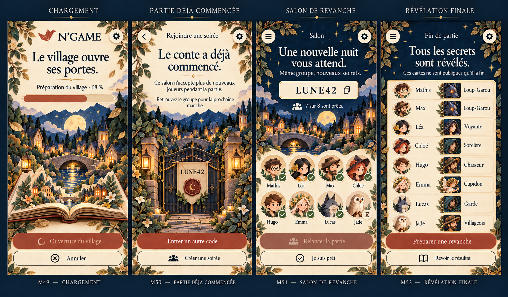

## Statut et points de validation

Ces images sont des propositions de structure et de direction artistique, pas des captures de fonctions nouvelles dans l’application. Certains parcours proposent des améliorations à développer après accord, dont la consultation initiale des rôles avant les pouvoirs temporisés, le QR et les réglages complémentaires.

Les textes, nombres et portraits sont illustratifs. Les avatars, compteurs, pictogrammes, tutoiement et vouvoiement devront être harmonisés lors de l’intégration ; une planche générée ne constitue pas une référence exacte au pixel. Les données de jeu, les durées, les droits de l’hôte et les cibles viendront du moteur.

Les huit rôles déjà pris en charge restent distingués des seize cartes du catalogue. La Petite Fille demande la table physique et n’obtient jamais une identité numérique de loup. Les mentions d’un appel externe, notamment C12, sont une ancienne proposition : prévoir désormais du vocal intégré distant **uniquement pendant le vote de jour**, fermé pendant Discussion et la nuit, ainsi qu’un chat écrit. Les [droits et variantes d’écran](../../../Documentation/COMMUNICATIONS-ET-VUES.md) précisent cette évolution ; aucune nouvelle fonction n’est intégrée par ces maquettes.

## Mouvement prévu

Les maquettes sont fixes. La réalisation gardera les nuages, la lune, l’eau et ses reflets, les lumières ancrées au décor, la brume, les étoiles et les cartes animées. Les textes et commandes tactiles resteront stables ; le réglage des mouvements réduits préservera les informations de jeu.

## Références et génération

Génération : outil intégré image_gen. Prompts complets, fichiers et inventaire dans [prompts-et-inventaire.json](prompts-et-inventaire.json). Références : planches de cartes et écrans validées dans ArtSource/ApprovedBoards, référence initiale ArtSource/reference-approved.png. Aucune illustration validée remplacée, aucune modification de l’interface Unity dans cette étape.

Pour la validation, utiliser les repères, par exemple : « garder E17, simplifier G28, revoir J38 ».
