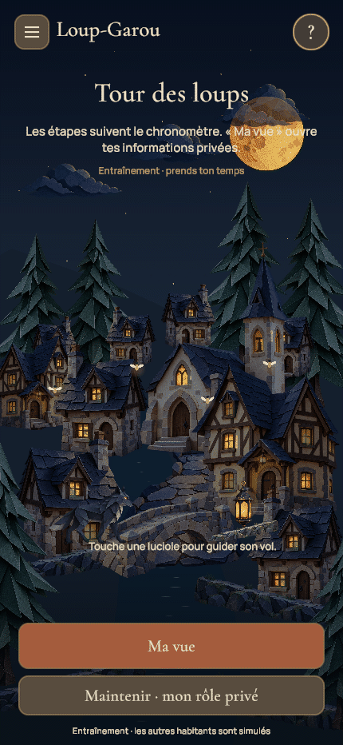

# N’GAME — Le village de papier

Application de jeux de soirée sous Unity, reconstruite dans ce nouveau dépôt. Le premier jeu est le Loup-Garou dans la direction artistique de conte en papier validée par Mathis. Le Président attend sa propre direction artistique.

## Version 0.3 — intégration en cours

Les lumières ont été reprises : le shader `HearthWindows` éclaire les vitres originales avec de faibles variations, en conservant murs et croisillons. Les flammes/halos plaqués et les forts reflets de rivière sont désactivés ou atténués. L’ancien atlas de feu reste historique, sans être le rendu actuel.

Les interfaces privées ont un cartouche de lecture et des réactions distinctes par rôle, liées à la sélection et au reçu autoritaire. Le mini-jeu de lucioles est ancré au village par projection caméra : la luciole quitte son point, vole vers la lanterne posée et laisse une trace discrète. Il n’a ni panneau central ni nouvelle commande réseau ; les quatre cibles de 44 points restent les seules zones qui reçoivent un contact.

La campagne Unity PlayMode complète finale réussit **98/98**, zéro échec/ignoré/inconclusif, en **160,93 s**. Elle couvre les dernières finitions : cartouche privé, chronomètre préservé, shader de vitres, lanterne posée, lucioles adoucies et observation Petite Fille. La dernière campagne Unity EditMode complète réussit **125/125** en **1,36 s**, zéro échec/ignoré/inconclusif. Les rendus finaux ont été relus. Le [build Mac courant](Documentation/qa-2026-10-20/build-mac-role-polish.json) compile sans erreur ; plist et signature ad hoc vérifiés, processus natif exact lancé. Cela ne constitue pas une recette UI native complète.

Les deux [recettes HTTP complètes](Documentation/qa-2026-10-20/full-match-http-validation.md), présence et distance, réussissent séparément avec 10 sessions simulées chacune : 2 nuits, 2 votes, 11 pouvoirs, 17 bulletins, victoire puis revanche. Elles couvrent aussi reprise, redémarrage serveur, droits de chat et relais PCM synthétique distant, sans prétendre dix personnes ni un essai de micro réel. Les anciens rapports et les 91 cas UI couverts par union restent des archives ; les résultats actuels sont les deux campagnes complètes 98/98 et 125/125. Aucun rendu corrigé n’est encore présenté comme accepté par Mathis.

**Passe locale et build Mac vérifiés techniquement ; nouveau push encore à vérifier. Hébergement public reporté à plus tard par Mathis.** [Bilan courant](Documentation/qa-2026-10-20/delivery-role-polish.md), [suivi détaillé](Documentation/SUIVI-PRODUCTION.md). Huit rôles de base seulement ; extensions sans moteur et Président/Mimes en préparation. Aucun jeu complet publié ou validé sur téléphone n’est annoncé.

- Salons de 6 à 24 personnes : code d’invitation, pseudonymes, portraits, confirmations et composition réglable par l’hôte.
- Distribution aléatoire avec découverte et confirmation individuelle avant les pouvoirs ; informations secrètes par destinataire, actions nocturnes, discussion, votes, verdict lisible, réactions, victoire et revanche.
- Huit rôles avec règles : Loup-Garou, Villageois, Voyante, Sorcière, Chasseur, Cupidon, Garde et Petite Fille. Les huit autres illustrations restent au catalogue, sans activation de règles absentes.
- Deux configurations : en présence et à distance, avec protocole nocturne explicite. La Petite Fille exige l’observation physique à table, yeux fermés, et est désactivée en mode écran ainsi qu’à distance.
- Messages écrits pendant le vote uniquement : Village pour les vivants, Village en lecture seule et Observateurs pour les éliminés. Aucun canal Meute ni historique accessible hors vote. Le dock passe les scénarios UI de vote et confidentialité ; les ACL passent 913 contrôles HTTP. Le vrai clavier mobile reste à éprouver. Relais vocal natif développé, limité au vote de jour distant et activé volontairement ; le microphone WebGL reste indisponible, avec secours écrit. Le transport audio est testé côté serveur, pas encore l’acoustique ou les permissions sur téléphone.
- Cadre commun avec commandes fixes, burger et confirmation de départ. Les actions privées s’ouvrent volontairement pour être utilisées à une main.
- Entraînement hors ligne avec sept habitants simulés et le même moteur de règles. Ce mode est explicitement individuel.
- Village en objets séparés : maisons, auberge, église, pont, chemin, berges, sapins, lune, trois groupes de nuages et étoiles ; eau géométrique et reflets indépendants, quatorze fenêtres dont les vitres illustrées reçoivent un éclairage intérieur distinct, loup de marche en huit poses.
- Cartes animées : apparition, inclinaison, dorures, effets de lumière et retournement. Les portraits restent rigides tant que leurs propres éléments séparés ne sont pas créés ; les rôles n’ont pas encore tous une articulation individuelle. Maintenir pour lire sa carte, relâcher pour la masquer. Le panneau d’action privée se ferme aux interruptions et changements de tour ; aucun effet du dos commun ne dépend du rôle caché.
- Fondu progressif nuit/aube dans les vraies parties ; son ambiant optionnel et mouvements réduits persistants.

Les règles et conventions N’GAME sont détaillées dans [WEREWOLF-RULESET.md](Documentation/WEREWOLF-RULESET.md). Les compositions et les formats six/sept demandent encore des essais d’équilibrage entre amis.

Les objets sont des illustrations de papier 2D indépendantes et des géométries simples ; les maisons ne sont pas des modèles 3D. Les portraits des cartes restent rigides, avec lumière et retournement, sans articulation de chaque personnage. Le corps et la tête du loup au repos sont séparés ; les oreilles ne le sont pas. La lanterne flottante a été supprimée : les lumières du village et la lanterne du mini-jeu restent ancrées.

## Essayer

Dans Unity Hub, ouvrir ce dossier avec **Unity 6000.6.6f1**, puis `Assets/NGame/Scenes/Storybook.unity` et **Play**. Le menu **NGame → Portrait Game View** règle l’aperçu en 430 × 932.

**S’entraîner seul** fonctionne sans serveur. Pour une vraie soirée, lancer sur le Mac :

```sh
bash Server/NGame.Server/run.sh
```

Le client utilise `http://127.0.0.1:8787` par défaut. Créer un village, puis le rejoindre avec d’autres clients utilisant le même serveur. Pour une future recette sur le même réseau, le [guide de table locale](Documentation/RECETTE-TABLE-LOCALE.md) fournit un lanceur exigeant explicitement l’adresse privée du Mac ; sa validation seule n’ouvre aucun port. Le détail du lancement et du service WebGL est dans [le README serveur](Server/NGame.Server/README.md).

Pour lire sa carte : maintenir le bouton inférieur, ou **Espace** sur ordinateur. Pour utiliser un pouvoir : ouvrir le panneau privé, sélectionner puis confirmer avec le bouton principal ; aucun second doigt maintenu n’est nécessaire. Ouvrir un menu ou perdre le focus masque les secrets. Le vote est une action publique de jour, avec choix personnel caché jusqu’à clôture.

Le serveur conserve maintenant les salles et reçus dans des sauvegardes privées atomiques. Le client natif conserve uniquement son accès de reprise, sans rôle privé en cache ; WebGL utilise le stockage de session de l’onglet. La reprise doit retrouver la même identité et les mêmes cartes. Un départ confirmé efface cet accès ; un pseudo seul ne récupère pas une place. Les contrôles de redémarrage serveur sont décrits dans [le README serveur](Server/NGame.Server/README.md).

L’hébergement Internet permanent est reporté à plus tard à la demande de Mathis. Il n’y a pas encore de compte, de build mobile signé ni de validation sur de vrais téléphones. La latence acoustique, l’écho, les accessoires, la batterie et les permissions du vocal natif restent à mesurer. Les fichiers de packaging et de confidentialité ne prouvent pas qu’un build mobile a été produit ou accepté par un store.

Le projet conserve aussi l’ancienne démonstration visuelle, avec rôle fixe et six portraits décoratifs. Elle ne constitue pas une vraie partie. Ses liens « Explorer le décor » et « La Veillée » ont été retirés de l’accueil normal pour éviter cette confusion ; le code reste disponible pour les outils de développement.

## Organisation et validation

| Dossier | Rôle |
| --- | --- |
| `Assets/NGame/Core` | Moteur pur, vues filtrées, catalogue, préférences et ancien aperçu |
| `Assets/NGame/Presentation` | Navigation, connexion HTTP, écrans, confidentialité et village animé |
| `Assets/NGame/Tests` | Règles EditMode et présentation PlayMode |
| `Server/NGame.Server` | Serveur ASP.NET Core 8 utilisant les mêmes sources de règles |
| `Assets/Resources/Werewolf` | Illustrations, polices et shaders du jeu |
| `ArtSource` | Références approuvées, sources et provenance |
| `Documentation` | Plan, conventions, captures et rapports de validation |

Les tests actuellement exécutés et leurs limites figurent dans [VALIDATION.md](Documentation/VALIDATION.md), et les tâches restantes dans [SUIVI-PRODUCTION.md](Documentation/SUIVI-PRODUCTION.md). Les objectifs mobiles, l’accessibilité et le profilage sur appareil restent à valider.



96 images réelles 430 × 932 sur 9,471 s, sans interpolation, avec clic vérifié par raycast EventSystem puis une luciole capturée — [manifest](Documentation/qa-2026-10-20/role-polish-night.json). Le [GIF privé Sorcière](Documentation/qa-2026-10-20/role-polish-witch-action.gif) montre 64 images sur 6,089 s : poison et cible sélectionnés dans l’interface, confirmation au moteur local (`submitted=true`, reçu 1) — [manifest](Documentation/qa-2026-10-20/role-polish-witch-action.json). Ces deux séquences proviennent du véritable entraînement Practice avec habitants simulés, pas d’une partie réseau ou humaine. Les [huit vues de rôles](Documentation/qa-2026-10-20/delivery-role-polish.md) sont des fixtures UI distinctes. Images et frames intermédiaires des GIF relues indépendamment, sans P1 visuel confirmé ; aucun test de performances sur téléphone ni réception artistique de Mathis n’en découle. Les anciens rendus `layered-*`, cutouts et du 17 octobre restent historiques.

## Assets

Illustrations générées à partir de la référence choisie ; inventaire initial dans [assets.json](ArtSource/Werewolf/assets.json), et nouveaux éléments séparés dans le [brief de génération](Documentation/Layer-asset-prompts.md) et les [empreintes d’assets](Documentation/ASSETS-ET-DEPENDANCES.md). Cormorant Garamond et Manrope sous SIL Open Font License, licences incluses. Aucun asset payant acheté.
