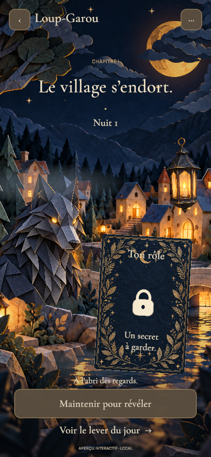
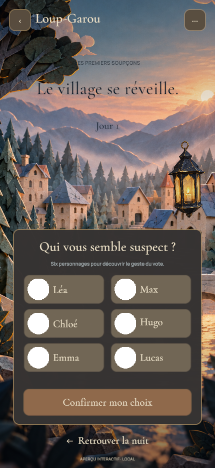

# N’GAME — Le village de papier

Application de jeux de soirée sous Unity, reconstruite depuis une base neuve. Premier chapitre : le Loup-Garou, dans un village de conte en papier plié, bleu nuit et lumière ambre. Le Président viendra après validation de sa direction artistique.

## Version actuelle

Un **aperçu local interactif**, pour valider le rendu et les gestes avant de développer une vraie partie entre amis :

- Accueil et aide ; préparateur de composition pour 6 à 12 personnes.
- Bibliothèque publique des 16 premières cartes validées, quatre pages et fiches illustrées ; les rôles ne sont pas encore jouables en réseau.
- Village nocturne : loup séparé, premier plan, brume et particules.
- Dix fenêtres/lanternes du décor et une lanterne suspendue avec halos et flammes indépendants, vacillement et extinction à l’aube.
- Eau animée par un shader limité à la rivière ; balancement de la lanterne et respiration du loup.
- Lune séparée et trois groupes de nuages mobiles. Maillage du loup avec mouvements indépendants de la tête, des oreilles et du thorax.
- Cartes : apparition, inclinaison au toucher/survol, portrait animé et reflets sur les dorures ; retournement de la carte secrète après maintien.
- Carte secrète : maintenir 0,65 s, relâcher pour masquer. Une interruption, un changement de phase ou un dialogue annule le geste.
- Transition nuit → aube → vote, sélection parmi six portraits décoratifs et confirmation locale verrouillée.
- Réglages persistants : ambiance sonore optionnelle et réduction des animations.

Les illustrations sont des textures 2D. Le village possède plusieurs plans et des effets calculés dans Unity ; les maisons ne sont pas encore des objets 3D indépendants. Le loup utilise un maillage de 2 793 sommets déformé autour du cou, des oreilles et du thorax. Il n’est pas un personnage 3D modélisé.

**Il n’y a pas encore de salon, de réseau, de distribution aléatoire, d’actions nocturnes, d’élimination ou de victoire.** Le rôle de cet aperçu est fixe. Les compositions proposées sont des hypothèses à tester avec de vrais groupes. Aucune donnée de joueur n’est envoyée par le code de l’application.

## Ouvrir le projet

1. Ajouter ce dossier à Unity Hub et l’ouvrir avec **Unity 6000.6.6f1**.
2. Laisser Unity restaurer les packages verrouillés et importer les assets.
3. Ouvrir `Assets/NGame/Scenes/Storybook.unity` et appuyer sur **Play**.
4. Utiliser **NGame → Portrait Game View** pour l’aperçu 430 × 932.

La scène est déjà enregistrée dans la liste de build. **NGame → Prepare Storybook Scene** permet de la reconstruire volontairement ; cette commande remplace la scène de démonstration. **NGame → Sync Approved Art** réimporte les PNG de `ArtSource/Werewolf` avec les réglages attendus.

Le premier import demande Internet pour les packages Unity. L’aperçu lui-même fonctionne hors ligne. Le plugin Unity utilise le package `com.unity.pipeline` ; il n’est pas requis pour jouer au build.

## Organisation

| Dossier | Rôle |
| --- | --- |
| `Assets/NGame/Core` | États locaux, règles de sélection, compositions et préférences ; C# indépendant de Unity |
| `Assets/NGame/Presentation` | Scène, navigation, interface uGUI/TMP, carte et animations |
| `Assets/NGame/Editor` | Préparation de la scène et import artistique |
| `Assets/NGame/Tests` | Tests EditMode et PlayMode |
| `Assets/Resources/Werewolf` | Illustrations, polices et shaders utilisés dans le build |
| `ArtSource` | Référence approuvée, illustrations sources et provenance de génération |
| `Documentation` | Plan complet, critères d’acceptation et validation de la version |

Les rôles privés d’une future partie ne doivent pas être mis dans l’état public du client. Le serveur de règles et les échanges entre téléphones restent à développer, comme décrit dans [le plan](Documentation/APP-PLAN.md).

Les deux modes sont prévus, avec priorité aux soirées dans la même pièce, chacun sur son téléphone. [Le dossier des rôles](Documentation/ROLE-DESIGN.md) distingue les mécanismes transposables et les adaptations nécessaires à distance, notamment pour la Petite Fille.

## Vérification

Lancer les suites `NGame.Core.Tests` en EditMode et `NGame.Presentation.Tests` en PlayMode depuis **Window → General → Test Runner**. Les tests de présentation couvrent le vrai maintien, les annulations et le masquage des objets graphiques. Voir [les commandes de test](Assets/NGame/Tests/README.md) et [le bilan de validation](Documentation/VALIDATION.md).

L’objectif est un produit mobile. Les builds iOS/Android, les gestes réels, l’autonomie, les performances et l’accessibilité sur appareil restent à vérifier. Les images fixes ci-dessous montrent le rendu Unity ; elles ne prouvent pas la fluidité mobile.

Un extrait du rendu animé est disponible dans `Documentation/village-motion.gif` : lune, nuages, eau, éclairages, loup et deux révélations de carte. C’est une capture du projet exécuté dans Unity, avec gestes de démonstration pilotés pour l’enregistrement.

| Nuit | Vote à l’aube |
| --- | --- |
|  |  |

## Assets

Illustrations générées à partir de la référence choisie ; prompts et dimensions dans [assets.json](ArtSource/Werewolf/assets.json). Polices Cormorant Garamond et Manrope sous SIL Open Font License, fichiers de licence inclus avec les polices. Pas d’asset payant acheté.
