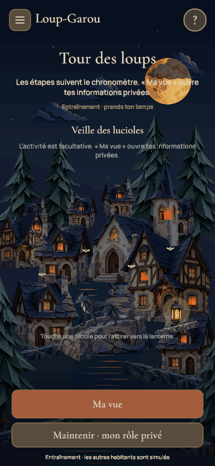

# N’GAME — Le village de papier

Application de jeux de soirée sous Unity, reconstruite dans ce nouveau dépôt. Le premier jeu est le Loup-Garou dans la direction artistique de conte en papier validée par Mathis. Le Président attend sa propre direction artistique.

## Version 0.3 — intégration en cours

Le village Loup-Garou est maintenant reconstruit avec des **bâtiments, arbres, pont, berges et chemin indépendants**. Le ciel et la rivière sont des géométries séparées ; les reflets sont des éléments distincts. Le rendu actif n’utilise plus un PNG complet de village ni `PaperRiver`. Chaque fenêtre possède une flamme de foyer masquée dans son ouverture, un halo ancré et ses propres variations chaudes de couleur et d’intensité. Le loup marche avec huit poses sur une rue commune.

Les pouvoirs ont un décor privé propre et un retour lié à la confirmation autoritaire ; les appels nocturnes ont aussi des vignettes publiques génériques, sans révéler les cibles. L’aide « ? » ouvre deux vrais boutons, règles et rôles. Le salon distingue **yeux fermés** et **nuit sur écran avec lucioles** : la Petite Fille reste physique et est refusée en mode écran ou à distance ; les appels du mode écran gardent une durée fixe côté serveur, même après soumission des acteurs. L’activité commune n’est pas une garantie d’anonymat des gestes.

Preuves disponibles : **125/125 Unity EditMode** en 1,68 s, **76/76 moteur hors Unity** et **214 contrôles/requêtes HTTP** pour le protocole nocturne. Le passage PlayMode complet obtient **90/91** en 162,02 s : seule une ancienne assertion attendait 10 masques de fenêtre au lieu des 14 actuels. Cette fixture est corrigée sans modification produit ; le retest ciblé réussit **19/19** en 17,28 s. L’union des deux rapports couvre **91 cas uniques réussis**, sans revendiquer une campagne unique 91/91.

Des finitions visuelles sont postérieures à ces rapports : village visible derrière la nuit écran, loup agrandi et cheminement aligné au pont, lanterne/son support déplacés à droite. Leurs retests ciblés réussissent : **5/5 village**, **20/20 vue joueur**, **3/3 lucioles**, zéro échec/ignoré/inconclusif. Ces trois suites ne constituent pas une nouvelle campagne complète de 91 cas ; les captures actuelles ont été relues.

Le build Mac courant compile : **zéro erreur**, 346 avertissements de shaders Unity AI Inference, 295 727 649 octets, 17 995 ms ; plist valide et signature locale ad hoc vérifiée. Son processus natif exact est confirmé ; cela ne constitue pas une recette complète de l’interface native. Les anciens 70/70 et build cutouts précèdent cette reconstruction et ne la valident pas. Les huit rôles d’extension restent sans moteur, Président/Mimes en préparation. Aucun jeu complet publié ou validé sur téléphone n’est annoncé.

Le build est prêt localement ; la reconstruction est sauvegardée sur `codex/werewolf-playable` au commit `9b45359b852b3260f314613f3bba1bf4e2b052d7`, SHA distant vérifié. **Hébergement public reporté à plus tard par Mathis, aucun déploiement dans ce lot.** [Bilan courant de la reconstruction](Documentation/qa-2026-10-20/delivery-layered-current.md), [suivi détaillé](Documentation/SUIVI-PRODUCTION.md).

- Salons de 6 à 24 personnes : code d’invitation, pseudonymes, portraits, confirmations et composition réglable par l’hôte.
- Distribution aléatoire avec découverte et confirmation individuelle avant les pouvoirs ; informations secrètes par destinataire, actions nocturnes, discussion, votes, verdict lisible, réactions, victoire et revanche.
- Huit rôles avec règles : Loup-Garou, Villageois, Voyante, Sorcière, Chasseur, Cupidon, Garde et Petite Fille. Les huit autres illustrations restent au catalogue, sans activation de règles absentes.
- Deux configurations : en présence et à distance, avec protocole nocturne explicite. La Petite Fille exige l’observation physique à table, yeux fermés, et est désactivée en mode écran ainsi qu’à distance.
- Messages écrits pendant le vote uniquement : Village pour les vivants, Village en lecture seule et Observateurs pour les éliminés. Aucun canal Meute ni historique accessible hors vote. Le dock passe les scénarios UI de vote et confidentialité ; les ACL passent 913 contrôles HTTP. Le vrai clavier mobile reste à éprouver. Relais vocal natif développé, limité au vote de jour distant et activé volontairement ; le microphone WebGL reste indisponible, avec secours écrit. Le transport audio est testé côté serveur, pas encore l’acoustique ou les permissions sur téléphone.
- Cadre commun avec commandes fixes, burger et confirmation de départ. Les actions privées s’ouvrent volontairement pour être utilisées à une main.
- Entraînement hors ligne avec sept habitants simulés et le même moteur de règles. Ce mode est explicitement individuel.
- Village en objets séparés : maisons, auberge, église, pont, chemin, berges, sapins, lune, trois groupes de nuages et étoiles ; eau géométrique et reflets indépendants, quatorze fenêtres avec foyers distincts, loup de marche en huit poses.
- Cartes animées : apparition, inclinaison, dorures, effets de lumière et retournement. Les portraits restent rigides tant que leurs propres éléments séparés ne sont pas créés ; les rôles n’ont pas encore tous une articulation individuelle. Maintenir pour lire sa carte, relâcher pour la masquer. Le panneau d’action privée se ferme aux interruptions et changements de tour ; aucun effet du dos commun ne dépend du rôle caché.
- Fondu progressif nuit/aube dans les vraies parties ; son ambiant optionnel et mouvements réduits persistants.

Les règles et conventions N’GAME sont détaillées dans [WEREWOLF-RULESET.md](Documentation/WEREWOLF-RULESET.md). Les compositions et les formats six/sept demandent encore des essais d’équilibrage entre amis.

Les objets sont des illustrations de papier 2D indépendantes et des géométries simples ; les maisons ne sont pas des modèles 3D. Les portraits des cartes restent rigides, avec lumière et retournement, sans articulation de chaque personnage. Le corps et la tête du loup au repos sont séparés ; les oreilles ne le sont pas. La lanterne flottante a été supprimée : les lumières du village et la lanterne du mini-jeu restent ancrées.

## Essayer

Dans Unity Hub, ouvrir ce dossier avec **Unity 6000.6.6f1**, puis `Assets/NGame/Scenes/Storybook.unity` et **Play**. Le menu **NGame → Portrait Game View** règle l’aperçu en 430 × 932.

**S’entraîner seul** fonctionne sans serveur. Pour une vraie soirée, lancer sur le Mac :

```sh
bash Server/NGame.Server/run.sh
```

Le client utilise `http://127.0.0.1:8787` par défaut. Créer un village, puis le rejoindre avec d’autres clients utilisant le même serveur. Pour une future recette sur le même réseau, le [guide de table locale](Documentation/RECETTE-TABLE-LOCALE.md) fournit un lanceur exigeant explicitement l’adresse privée du Mac ; sa validation seule n’ouvre aucun port. Le détail du lancement et du service WebGL est dans [le README serveur](Server/NGame.Server/README.md).

Pour lire sa carte : maintenir le bouton inférieur, ou **Espace** sur ordinateur. Pour utiliser un pouvoir : ouvrir le panneau privé, sélectionner puis confirmer avec le bouton principal ; aucun second doigt maintenu n’est nécessaire. Ouvrir un menu ou perdre le focus masque les secrets. Le vote est une action publique de jour, avec choix personnel caché jusqu’à clôture.

Le serveur conserve maintenant les salles et reçus dans des sauvegardes privées atomiques. Le client natif conserve uniquement son accès de reprise, sans rôle privé en cache ; WebGL utilise le stockage de session de l’onglet. La reprise doit retrouver la même identité et les mêmes cartes. Un départ confirmé efface cet accès ; un pseudo seul ne récupère pas une place. Les contrôles de redémarrage serveur sont décrits dans [le README serveur](Server/NGame.Server/README.md).

L’hébergement Internet permanent est reporté à plus tard à la demande de Mathis. Il n’y a pas encore de compte, de build mobile signé ni de validation sur de vrais téléphones. La latence acoustique, l’écho, les accessoires, la batterie et les permissions du vocal natif restent à mesurer. Les fichiers de packaging et de confidentialité ne prouvent pas qu’un build mobile a été produit ou accepté par un store.

Le projet conserve aussi l’ancienne démonstration visuelle, avec rôle fixe et six portraits décoratifs. Elle ne constitue pas une vraie partie. Ses liens « Explorer le décor » et « La Veillée » ont été retirés de l’accueil normal pour éviter cette confusion ; le code reste disponible pour les outils de développement.

## Organisation et validation

| Dossier | Rôle |
| --- | --- |
| `Assets/NGame/Core` | Moteur pur, vues filtrées, catalogue, préférences et ancien aperçu |
| `Assets/NGame/Presentation` | Navigation, connexion HTTP, écrans, confidentialité et village animé |
| `Assets/NGame/Tests` | Règles EditMode et présentation PlayMode |
| `Server/NGame.Server` | Serveur ASP.NET Core 8 utilisant les mêmes sources de règles |
| `Assets/Resources/Werewolf` | Illustrations, polices et shaders du jeu |
| `ArtSource` | Références approuvées, sources et provenance |
| `Documentation` | Plan, conventions, captures et rapports de validation |

Les tests actuellement exécutés et leurs limites figurent dans [VALIDATION.md](Documentation/VALIDATION.md), et les tâches restantes dans [SUIVI-PRODUCTION.md](Documentation/SUIVI-PRODUCTION.md). Les objectifs mobiles, l’accessibilité et le profilage sur appareil restent à valider.



96 images réelles 430 × 932 sur 9,677 s, sans interpolation. Le [panneau privé des loups](Documentation/qa-2026-10-20/layered-wolves-private-final.png) et l’[aide « ? »](Documentation/qa-2026-10-20/layered-help-question.png) ont été relus. Les scènes montrent un entraînement Practice avec habitants simulés, pas une partie réseau ou humaine ; aucun de ces fichiers ne mesure les performances sur téléphone. Les rendus cutouts et le GIF du 17 octobre restent des archives.

## Assets

Illustrations générées à partir de la référence choisie ; inventaire initial dans [assets.json](ArtSource/Werewolf/assets.json), et nouveaux éléments séparés dans le [brief de génération](Documentation/Layer-asset-prompts.md) et les [empreintes d’assets](Documentation/ASSETS-ET-DEPENDANCES.md). Cormorant Garamond et Manrope sous SIL Open Font License, licences incluses. Aucun asset payant acheté.
