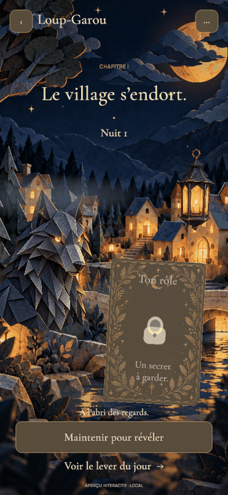

# N’GAME — Le village de papier

Application de jeux de soirée sous Unity, reconstruite dans ce nouveau dépôt. Le premier jeu est le Loup-Garou dans la direction artistique de conte en papier validée par Mathis. Le Président attend sa propre direction artistique.

## Version 0.3 — intégration en cours

La version locale du 20 octobre comprend le hub des jeux, huit rôles jouables, un entraînement guidé et les messages en dock du bas pendant le vote uniquement. La dernière campagne globale passe **116/116 EditMode** et **56/56 PlayMode** ; le hub universel animé, révisé ensuite, passe **10/10 tests ciblés** (ce n’est pas une nouvelle campagne globale). Ses captures normales, zone sûre réduite et création ainsi que 64 images réelles d’animation sur 6,37 s sont relues ; le décor Loup-Garou reste propre au jeu. Cette présentation est livrée localement pour validation de Mathis, sans accord utilisateur inventé. Le build Mac actuel compile (zéro erreur, 346 avertissements de packages AI) avec plist et signature locale vérifiés ; l’interface est observée dans Unity, pas encore validée dans l’app native. Sources poussées sur [codex/werewolf-playable](https://github.com/veloci11/N-game/tree/codex/werewolf-playable), premier snapshot `6b71fea`. Cela ne constitue pas un déploiement public. Téléphones, acoustique et partie humaine restent non validés. Le [suivi de production](Documentation/SUIVI-PRODUCTION.md) distingue chaque état et sa preuve.

- Salons de 6 à 24 personnes : code d’invitation, pseudonymes, portraits, confirmations et composition réglable par l’hôte.
- Distribution aléatoire avec découverte et confirmation individuelle avant les pouvoirs ; informations secrètes par destinataire, actions nocturnes, discussion, votes, verdict lisible, réactions, victoire et revanche.
- Huit rôles avec règles : Loup-Garou, Villageois, Voyante, Sorcière, Chasseur, Cupidon, Garde et Petite Fille. Les huit autres illustrations restent au catalogue, sans activation de règles absentes.
- Deux configurations : en présence et à distance. La Petite Fille exige l’observation physique à table et est désactivée à distance.
- Messages écrits pendant le vote uniquement : Village pour les vivants, Village en lecture seule et Observateurs pour les éliminés. Aucun canal Meute ni historique accessible hors vote. Le dock passe les scénarios UI de vote et confidentialité ; les ACL passent 913 contrôles HTTP. Le vrai clavier mobile reste à éprouver. Relais vocal natif développé, limité au vote de jour distant et activé volontairement ; le microphone WebGL reste indisponible, avec secours écrit. Le transport audio est testé côté serveur, pas encore l’acoustique ou les permissions sur téléphone.
- Cadre commun avec commandes fixes, burger et confirmation de départ. Les actions privées s’ouvrent volontairement pour être utilisées à une main.
- Entraînement hors ligne avec sept habitants simulés et le même moteur de règles. Ce mode est explicitement individuel.
- Village animé : lune et trois groupes de nuages séparés, eau et reflets, dix lumières ancrées au décor, flammes irrégulières, brume, fumée de cheminée, étoiles, branches et maillage articulé du loup.
- Cartes animées : apparition, inclinaison, portrait, dorures et retournement. Maintenir pour lire sa carte, relâcher pour la masquer. Le panneau d’action privée se ferme aux interruptions et changements de tour ; aucun effet du dos commun ne dépend du rôle caché.
- Fondu progressif nuit/aube dans les vraies parties ; son ambiant optionnel et mouvements réduits persistants.

Les règles et conventions N’GAME sont détaillées dans [WEREWOLF-RULESET.md](Documentation/WEREWOLF-RULESET.md). Les compositions et les formats six/sept demandent encore des essais d’équilibrage entre amis.

Le décor utilise des illustrations 2D en plusieurs plans, des shaders et un loup déformé sur un maillage de 2 793 sommets. Les maisons ne sont pas encore des objets 3D indépendants. La lanterne flottante a été supprimée ; les lumières du village restent à leur place.

## Essayer

Dans Unity Hub, ouvrir ce dossier avec **Unity 6000.6.6f1**, puis `Assets/NGame/Scenes/Storybook.unity` et **Play**. Le menu **NGame → Portrait Game View** règle l’aperçu en 430 × 932.

**S’entraîner seul** fonctionne sans serveur. Pour une vraie soirée, lancer sur le Mac :

```sh
bash Server/NGame.Server/run.sh
```

Le client utilise `http://127.0.0.1:8787` par défaut. Créer un village, puis le rejoindre avec d’autres clients utilisant le même serveur. Les appareils du réseau local utilisent l’adresse réseau du Mac et un serveur lancé avec `ASPNETCORE_URLS=http://0.0.0.0:8787`. Le détail du lancement et du service WebGL est dans [le README serveur](Server/NGame.Server/README.md).

Pour lire sa carte : maintenir le bouton inférieur, ou **Espace** sur ordinateur. Pour utiliser un pouvoir : ouvrir le panneau privé, sélectionner puis confirmer avec le bouton principal ; aucun second doigt maintenu n’est nécessaire. Ouvrir un menu ou perdre le focus masque les secrets. Le vote est une action publique de jour, avec choix personnel caché jusqu’à clôture.

Le serveur conserve maintenant les salles et reçus dans des sauvegardes privées atomiques. Le client natif conserve uniquement son accès de reprise, sans rôle privé en cache ; WebGL utilise le stockage de session de l’onglet. La reprise doit retrouver la même identité et les mêmes cartes. Un départ confirmé efface cet accès ; un pseudo seul ne récupère pas une place. Les contrôles de redémarrage serveur sont décrits dans [le README serveur](Server/NGame.Server/README.md).

Il n’y a pas encore d’hébergement Internet permanent, de compte, de build mobile signé ni de validation sur de vrais téléphones. La latence acoustique, l’écho, les accessoires, la batterie et les permissions du vocal natif restent à mesurer. Les fichiers de packaging et de confidentialité ne prouvent pas qu’un build mobile a été produit ou accepté par un store.

Le projet conserve aussi l’ancienne démonstration visuelle, avec rôle fixe et six portraits décoratifs. Elle ne constitue pas une vraie partie. Ses liens « Explorer le décor » et « La Veillée » ont été retirés de l’accueil normal pour éviter cette confusion ; le code reste disponible pour les outils de développement.

## Organisation et validation

| Dossier | Rôle |
| --- | --- |
| `Assets/NGame/Core` | Moteur pur, vues filtrées, catalogue, préférences et ancien aperçu |
| `Assets/NGame/Presentation` | Navigation, connexion HTTP, écrans, confidentialité et village animé |
| `Assets/NGame/Tests` | Règles EditMode et présentation PlayMode |
| `Server/NGame.Server` | Serveur ASP.NET Core 8 utilisant les mêmes sources de règles |
| `Assets/Resources/Werewolf` | Illustrations, polices et shaders du jeu |
| `ArtSource` | Références approuvées, sources et provenance |
| `Documentation` | Plan, conventions, captures et rapports de validation |

Les tests actuellement exécutés et leurs limites figurent dans [VALIDATION.md](Documentation/VALIDATION.md), et les tâches restantes dans [SUIVI-PRODUCTION.md](Documentation/SUIVI-PRODUCTION.md). Les objectifs mobiles, l’accessibilité et le profilage sur appareil restent à valider.



Cette capture du 17 octobre montre le décor exécuté dans Unity, avec deux maintiens pilotés pour l’enregistrement. Elle ne représente pas la nouvelle interface du 20 octobre et ne mesure pas les performances sur téléphone.

## Assets

Illustrations générées à partir de la référence choisie ; prompts et dimensions dans [assets.json](ArtSource/Werewolf/assets.json). Cormorant Garamond et Manrope sous SIL Open Font License, licences incluses. Aucun asset payant acheté.
